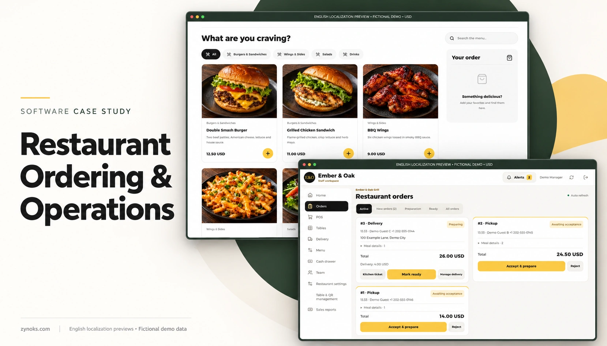
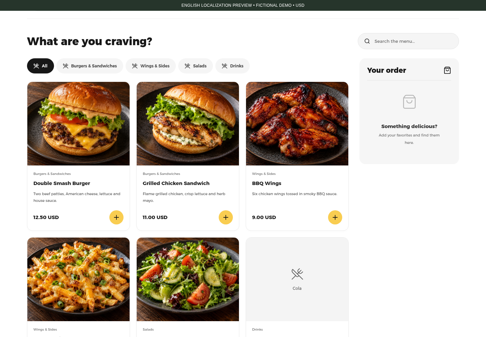
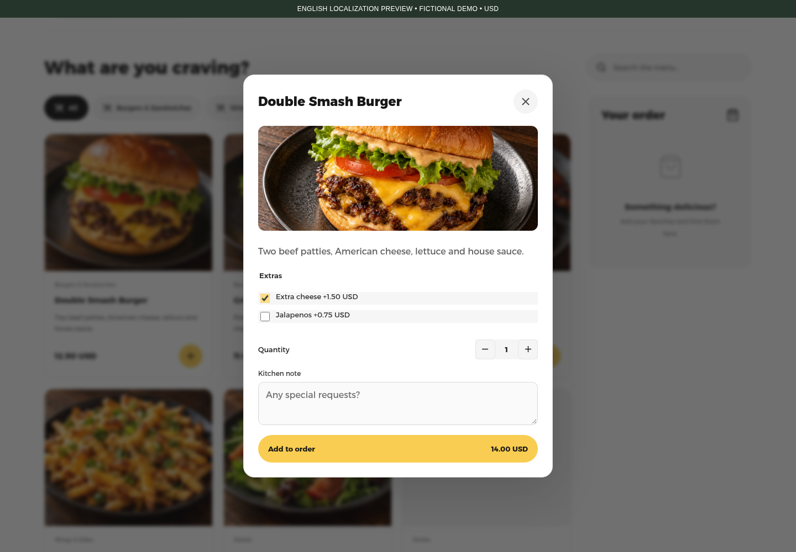
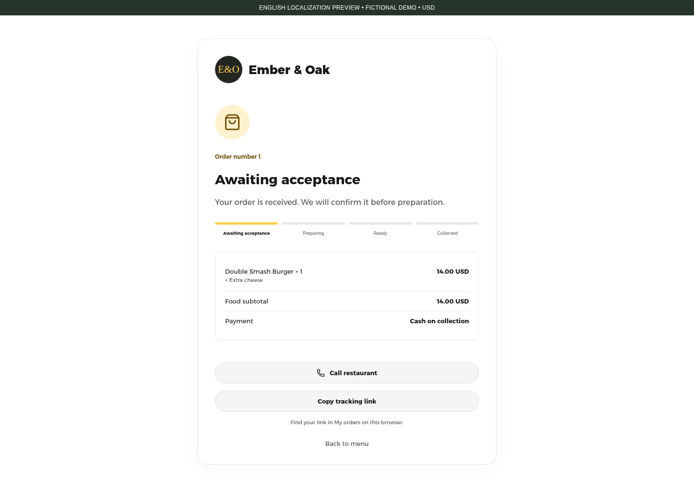
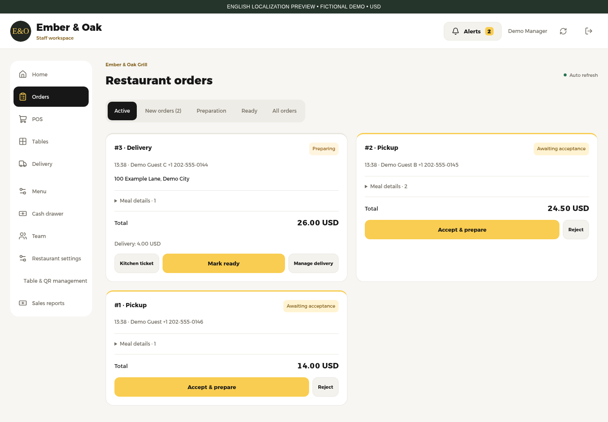
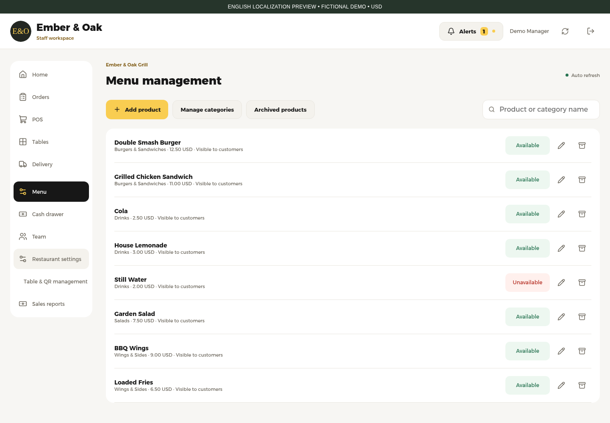
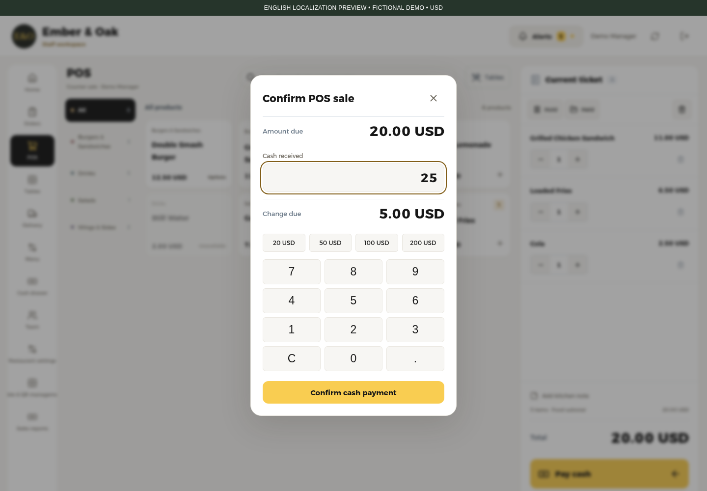
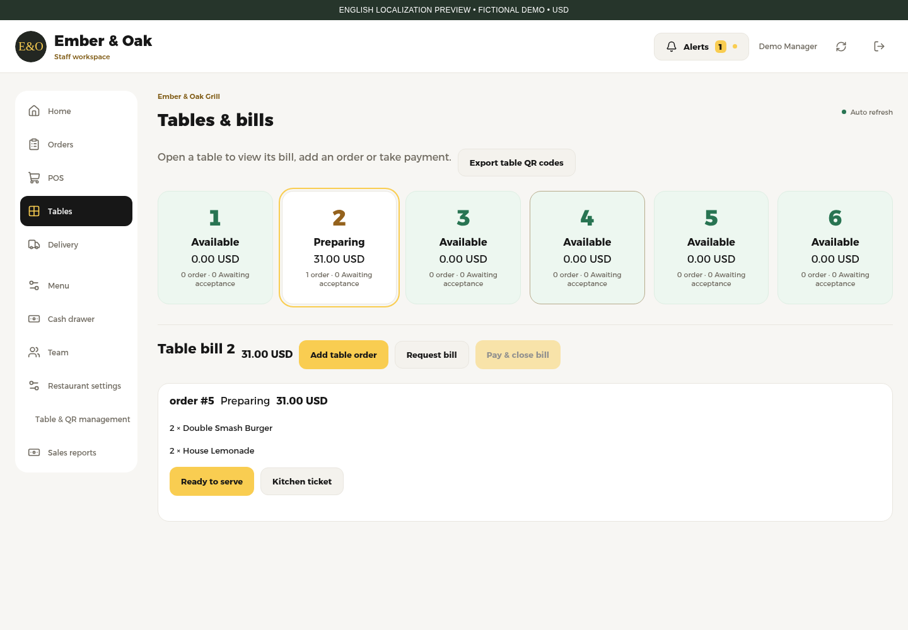
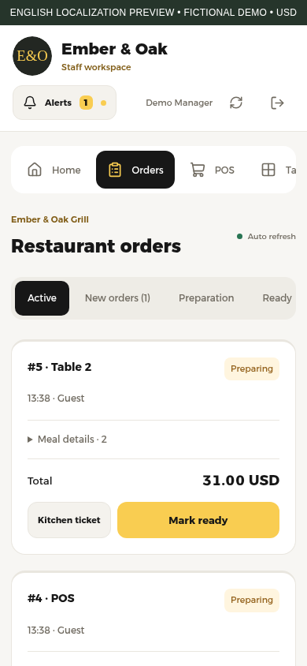

# Restaurant Ordering & Operations Platform

A custom restaurant platform connecting customer ordering with the work behind the counter: accepting orders, preparing food, serving tables and recording cash.

**Screenshots use a fictional restaurant and demonstration data. Client identity and live systems are not shared.**

This repository is a portfolio case study by [Zynoks](https://zynoks.com/). It contains documentation and selected media. Application source, downloads and access to live systems are not offered here.

**About the English visuals:** The implemented interface is Arabic with Moroccan currency and phone validation. Every interface image below is a labeled English localization preview captured from a disposable local copy, with translated browser text, left-to-right presentation and illustrative USD formatting. These previews retain the implemented screens and workflows; they do not establish existing English or US-market support. [Evidence and adaptation scope](VERIFICATION.md).

## Help customers place an order

Customers can browse categories, search the menu, choose extras and quantities, and submit a pickup or delivery request. Table-specific links also support dining orders. A saved tracking link shows the order's progress after submission. Guest requests wait for staff acceptance.

*Browse a fictional casual-grill menu by category. Menu prices and food photography are demonstration content.*

*Choose an extra before adding a burger to the order. The underlying product-option and pricing flow was exercised locally.*

*See that a pickup request has arrived and is awaiting acceptance. The same local order subsequently reached preparing and ready.*

## Give staff a clear next action

Staff receive guest orders in a shared queue, review the details, accept or reject requests, and advance accepted orders through preparation and fulfillment. Delivery acceptance includes confirmation of the delivery fee. Payment and food preparation are tracked separately.

*Review new pickup requests alongside an accepted delivery order in preparation.*

## Connect the counter, tables and menu

| Restaurant task | Implemented tools |
| --- | --- |
| Counter sales | Product selection, editable tickets, held local tickets, server-priced checkout, cash tender and change |
| Table service | Staff additions, guest requests, preparation and served states, one combined bill and cash payment |
| Menu control | Categories, prices, variants, extras, photos, availability and archive/restore |
| Cash accountability | Opening float, cash movements, receipts, closing counts and discrepancies |
| Delivery | Assignment, fulfillment, customer cash collection and separate selected-order handover to the drawer |
| Owner management | Service settings, hours, staff accounts, tables and payment-day reports |

Availability means whether an item can be ordered. Quantity-based stock and ingredient inventory are not implemented. Payments are cash-based; no card processor is demonstrated.

*Manage which menu items customers can order, alongside prices and product editing controls.*

*Review a 20.00 USD demonstration ticket, enter 25.00 USD received and see 5.00 USD change before confirming.*

*View a table's current bill and advance its food toward service before combined checkout.*

## Work across screen sizes

The customer website and staff browser interface adapt to smaller screens. A separate Expo/React Native staff application implements order, counter, table, delivery and management routes with shared work state and bounded local recovery.

*Phone-width staff browser view. This is a web interface preview, not a native-app screenshot. The native application was reviewed in source and passed typecheck and lint; physical-device behavior was not tested for this case study.*

## Project contribution and technology

The engineering scope spans the customer ordering website, operational browser interfaces, a native staff application, an Express API and PostgreSQL-backed order and cash workflows. Shared pricing logic, historical order snapshots, retry identifiers and transactional checks connect these surfaces.

The verified stack is **React and Vite with JavaScript**, **Express and PostgreSQL**, and **Expo 57 / React Native with TypeScript** for the staff app. This is a separate-deployment architecture for each restaurant, rather than a demonstrated multi-tenant subscription service.

Read the [case study](CASE_STUDY.md) for workflow details, [verification notes](VERIFICATION.md) for evidence and limits, and [media provenance](assets/PROVENANCE.md) for how the visuals were prepared. No claim is made that every module is actively used by a client or that the full platform is production-ready.

## Discuss a similar project

Need a similar ordering website or staff system for your restaurant? Explore my work at [zynoks.com](https://zynoks.com/) or contact [contact@zynoks.com](mailto:contact@zynoks.com).

[LinkedIn](https://www.linkedin.com/in/zynoks) · [Contact](CONTACT.md) · [Rights and usage](RIGHTS.md)
